<div align="center">

**Readme Language / Sprache：**
[English](../README.md)｜[日本語](ja.md)｜[한국어](ko.md)｜[Русский](ru.md)｜[Français](fr.md)｜[Deutsch](de.md)｜[Español](es.md)｜[Português](pt.md)｜[简体中文](zh.md)｜[繁體中文](tw.md)


💖 Unterstütze dieses Projekt: [Ko‑fi](https://ko-fi.com/edenls)

</div>

# SnipOCR
> Hochleistungs‑Screenshot‑, Desktop‑Sticker‑ und Offline‑OCR‑Dienstprogramm für Windows, entwickelt mit C++17 / Qt6.

SnipOCR ist ein quelloffenes All‑in‑One‑Desktop‑Dienstprogramm für Windows 10 / 11 x64. Es kombiniert Hochleistungs‑Screenshots, schwebende Desktop‑Sticker‑Vorschau, Bildanmerkungen, mehrsprachige Offline‑OCR‑Erkennung, verzögerte Schleifen‑Screenshots und eine automatische Aktualisierungsfunktion.

**Unterstützte UI‑Sprachen: Vereinfachtes‑Chinesisch, Traditionelles‑Chinesisch, Englisch, Japanisch, Koreanisch, Deutsch, Französisch, Russisch. Die OCR‑Texterkennung ist für alle oben genannten Sprachen verfügbar.**

Alle Bild‑ und Texterkennungsvorgänge laufen **lokal auf deinem Gerät ab. Screenshots werden niemals in die Cloud hochgeladen – deine Privatsphäre bleibt geschützt.**
Geeignet für die Extraktion von Büromaterialien, Lese‑ und Übersetzungshilfen, Texterfassung aus Webdokumenten, Erfassen von Entwickler‑Assets sowie Screenshot‑Anmerkungen für Lehrdemonstrationen und viele weitere Szenarien.

Entwickelt mit nativen Windows‑APIs und Qt6. Unterstützt Hoch‑DPI‑Mehrmonitor‑Konfigurationen, bietet Hell‑/Dunkel‑Designs, eine vollständig internationalisierte mehrsprachige Benutzeroberfläche und kann über das System‑Tray im Hintergrund ausgeführt werden.

---
## Demo
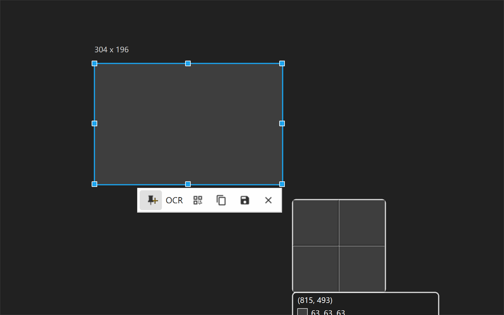
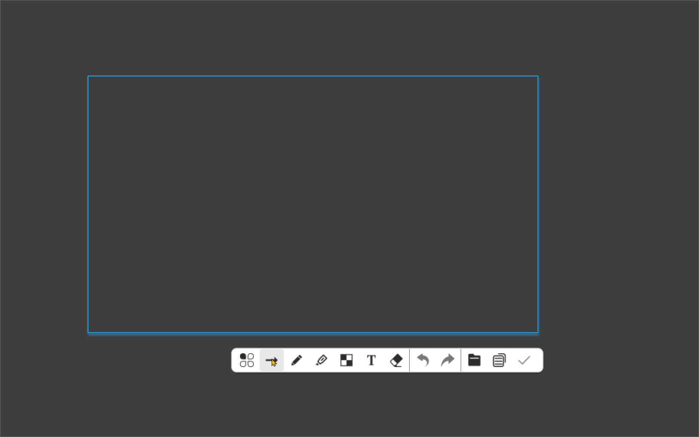
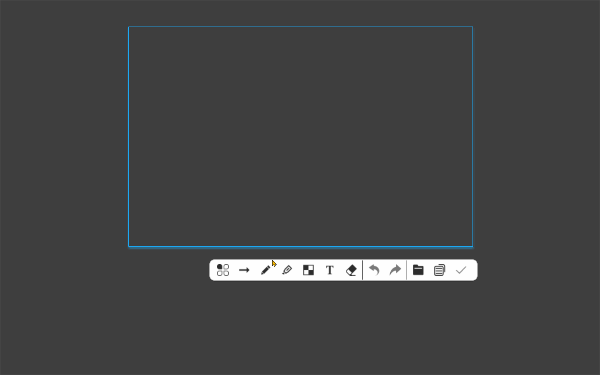
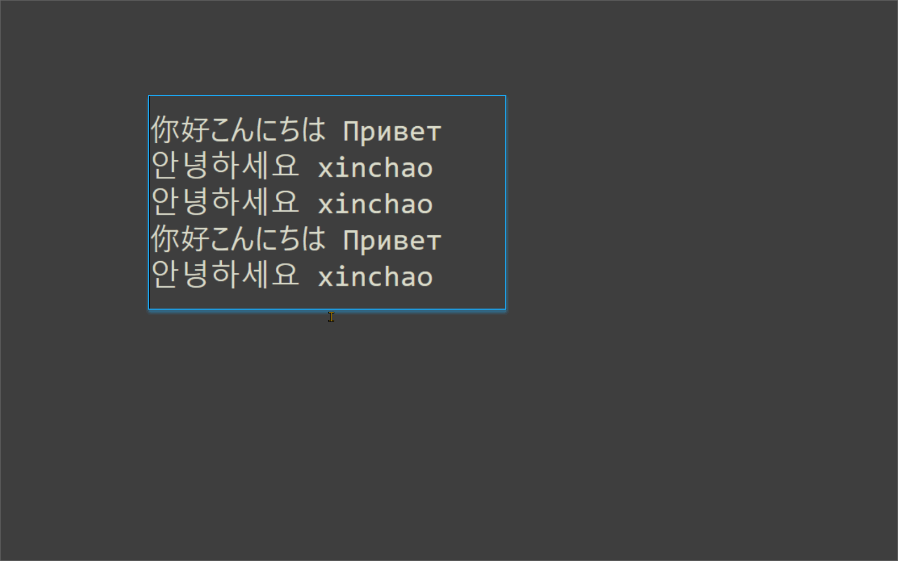
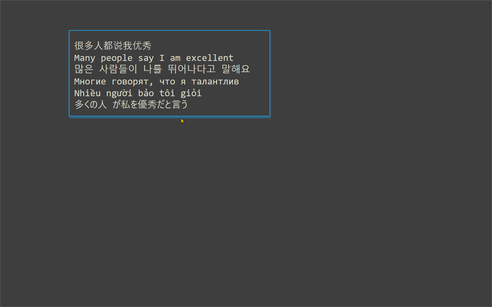
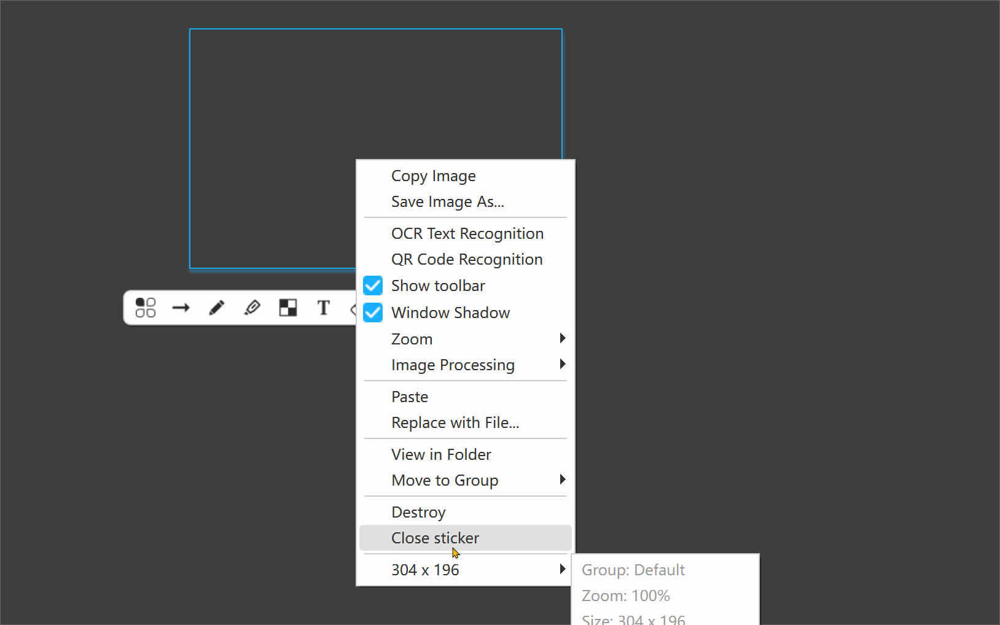
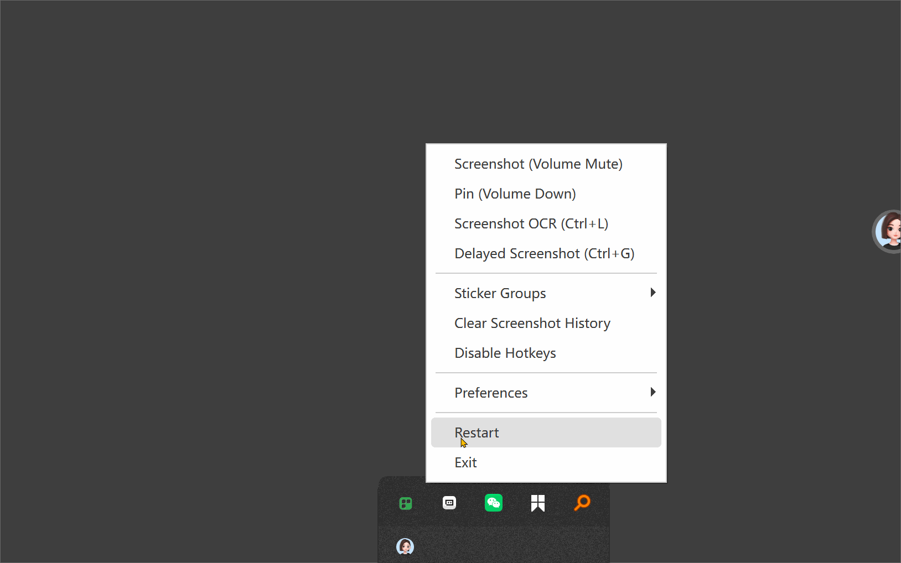
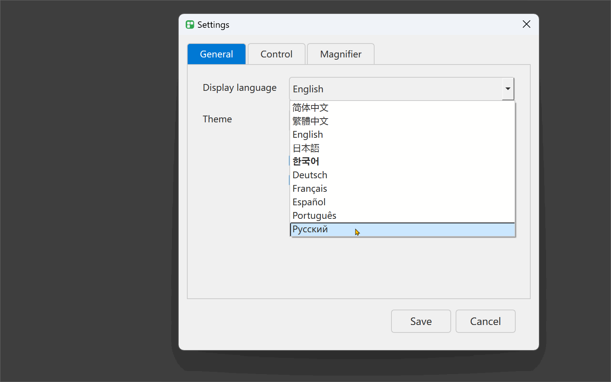
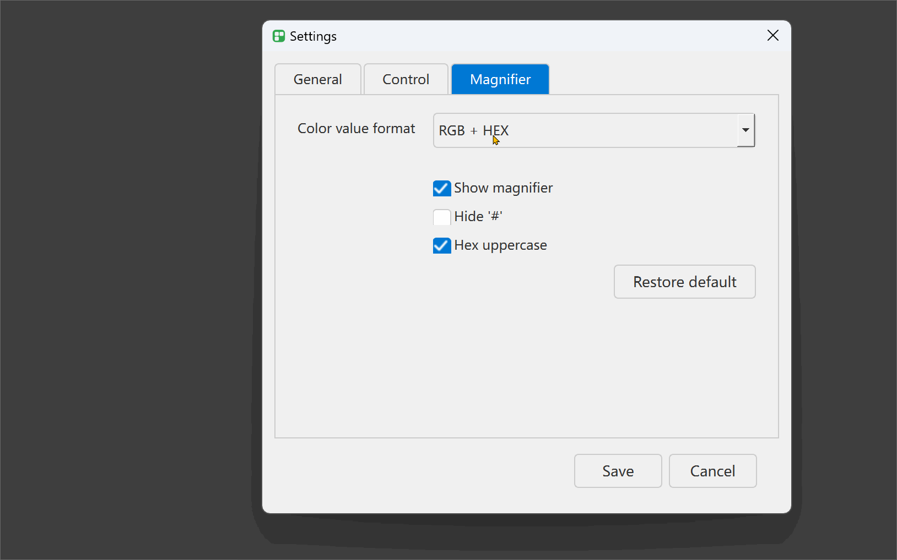

## Funktionen
### 📷 Screenshot‑Modul
- **Globaler Hotkey‑Screenshot**: Realisiert über den Windows‑Low‑Level‑Tastatur‑Hook `WH_KEYBOARD_LL`. Der Screenshot‑Vorgang wird mit einem Hotkey unabhängig vom aktiven Fenster‑Fokus ausgelöst.
- **Freie Bereichsauswahl**: Ziehe mit der Maus ein Auswahlrechteck mit 8 Größen‑Steuerpunkten. Feineinstellung über Pfeiltasten: 1‑Pixel‑Schritt, `Umschalt + Pfeiltaste` für 10‑Pixel‑Bewegung zur präzisen Pixel‑Auswahl.
- **Fenster‑Snip‑to‑Edge**: Inspiriert von Snipaste. Auswahlränder schnappen automatisch an Fensterränder (Standard‑Schwelle 8 Pixel) für schnelle Vollfenster‑Aufnahmen.
- **Genauige Fenster‑ und Steuerelement‑Erkennung**: Verwendet `WindowFromPoint` + `RealChildWindowFromPoint` zum Erkennen von Untersteuerelementen wie Schaltflächen, Eingabefeldern und Symbolleisten zur direkten Auswahl von Steuerelement‑Bereichen.
- **DWM‑Abfrage echter Fenstergrenzen**: Ruft `DwmGetWindowAttribute(DWMWA_EXTENDED_FRAME_BOUNDS)` auf, um Fensterschatten auszuschließen und die tatsächliche gerenderte Fenstergröße zu ermitteln.
- **Pixel‑Lupe**: Lupe‑Overlay im Aufnahmemodus mit Anzeige von RGB‑ / HEX‑Farbwerten und Bildschirmkoordinaten. Farbformat umschaltbar für Farbauswahl und Pixel‑Prüfung.
- **Auswahl‑Größen‑Label**: Abgerundetes blau hinterlegtes `W × H`‑Größen‑Label in der Nähe der Auswahl. Textfarbe passt sich automatisch Hell‑/Dunkel‑Design an.
- **Screenshot‑Werkzeugleiste**: Untere Werkzeugleiste erscheint nach der Bereichsaufnahme. Unterstützt Sticker‑Anheften, OCR‑Erkennung, QR‑Code‑Erkennung, Bild‑Kopieren, Speichern als PNG und Abbrechen.

### 🖼️ Desktop‑Sticker & Anmerkungen
- **Schwebende Desktop‑Sticker**: Angefertigte Screenshots direkt an der ursprünglichen Position auf dem Bildschirm anheften (ähnlich Snipaste). Volle DPR‑Geräte‑Pixel‑Ratio‑Unterstützung gegen Unschärfe auf Hochauflösungs‑Displays.
- **Vollständiges Anmerkungs‑Werkzeugset**: Rechtsklick öffnet Zeichen‑Werkzeugleiste: Auswahl, Stift, Pfeil, Rechteck, Ellipse, Hervorhebung, Mosaik‑Pixelierung, Text‑Notiz, Radiergummi.
- **Bild‑Transformation**: Sticker unterstützen Skalierung von 20 %‑500 %; 90‑Grad‑Uhrzeiger‑ / Gegen‑Uhrzeiger‑Rotation, horizontale & vertikale Spiegelung. Alle Operationen arbeiten mit der physischen Original‑Bildauflösung ohne Qualitätsverlust.
- **Anmerkungen einbrennen & exportieren**: Alle gezeichneten Anmerkungen mit dem Quellbild verschmelzen und als PNG mit ursprünglicher Auflösung exportieren.
- **Bildschirm‑Farbauswahl‑Panel**: Eigenständige Farbauswahl‑Implementierung zum Auslesen beliebiger Bildschirmpixel, kompatibel mit mehrsprachiger Benutzeroberfläche.
- **Sticker‑Fenster‑Schatten umschalten**: Schatteneffekt für Sticker‑Fenster aktivieren/deaktivieren – passend zum nativen Windows 11‑Rund‑Ecken‑Visuellen‑Stil.
- **Sticker‑Gruppen‑Verwaltung**: Mehrere Sticker‑Gruppen (Standard‑Gruppe + benutzerdefinierte Gruppen). Gruppenwechsel blendet aktuelle‑Gruppen‑Sticker aus und stellt das Layout einer anderen Gruppe wieder her.
- **Persistenter Screenshot‑Verlauf**: Originale Screenshots werden als PNG im lokalen Ordner `history` gespeichert. Sticker‑Position, Skalierung und Anmerkungs‑Zustände liegen in `.sp1`‑Dateien mit leichter XOR+Base64‑Verschleierung vor (keine starke Verschlüsselung, nur Schutz vor unbeabsichtigter Änderung).
- **Automatische Sticker‑Wiederherstellung bei Neustart**: Beim Neustart der Anwendung werden alle schwebenden Sticker mit letzter Position, Skalierung und Gruppenzuordnung wiederhergestellt.

### 🔍 Offline‑OCR‑Texterkennung
- **Paralleles Mehr‑Modell‑Laden**: Mehrere Erkennungs‑Modelle gleichzeitig laden. Unterstützt gemischt Chinesisch‑Englisch, Koreanisch, Russisch‑Kyrillisch‑Schrift und Latein‑Schrift‑Text.
- **Automatische Spracherkennung**: Algorithmus analysiert Zeichen‑Anteile im Bild und wechselt automatisch zum passenden OCR‑Modell – keine manuelle Sprachauswahl nötig.
- **ONNX Runtime‑CPU‑Inferenz**: Läuft rein auf CPU. **Separate Grafikkarte ist nicht erforderlich**, funktioniert auf normalen Laptops.
- **Nicht‑blockierender Hintergrund‑Arbeits‑Thread**: OCR‑Aufgaben laufen in unabhängigem QThread‑Worker, sodass die Benutzeroberfläche während der Erkennung reagibel bleibt.
- **Erkennungs‑Ergebnis‑Dialog**: Bearbeitbares OCR‑Ausgabefenster. Unterstützt Ein‑Klick‑Kopieren in die Zwischenablage und Speichern von Text in eine lokale Datei.

### ⏱️ Verzögerter Screenshot
- **Verzögerte & wiederholte Aufnahme**: Verzögerung von 1‑10 Sekunden einstellen, Anzahl von Wiederholungs‑Aufnahmen konfigurieren für stapelweises automatisches Speichern.
- **System‑Toast‑Benachrichtigung**: Native Windows‑Popup‑Meldung nach Abschluss der Aufnahme‑Sequenz mit Speicherpfad und Anzahl der Aufnahmen. Klick auf Benachrichtigung kopiert den Dateipfad.

### 🔄 Automatisches Aktualisierungs‑System
- **Versions‑Prüfung**: Automatische Versions‑Prüfung beim Start; manuelle Prüfung im Einstellungs‑Panel möglich.
- **Delta‑Aktualisierungs‑Mechanismus**: Erstellt Voll‑Release‑Pakete und differenzielle Patch‑Pakete auf Basis einer Basis‑Version. Nur geänderte Dateien werden heruntergeladen, um Download‑Größe zu senken.
- **Duale‑Quellen‑Routing**: Gitee‑Download‑Quelle für Festland‑China‑Benutzer, GitHub‑Releases für Übersee‑Benutzer zur Lösung von Netzwerk‑Zugriff‑Unterschieden.
- **Unabhängiges Aktualisierungs‑Binärprogramm**: `updater.exe` auf Basis roher Win32‑API + minizip, keine Qt‑Abhängigkeiten.
- **Konfiguration & Benutzerdaten erhalten**: Sicherung der Benutzer‑Konfigurationsdatei `.config_settings.json` während der Aktualisierung. Wiederherstellung der Einstellungen nach dem Update; Hotkeys, Designs und Sticker‑Gruppen‑Einstellungen bleiben erhalten.
- **Aktualisierungs‑Neustart‑Ablauf**: Nach Abschluss des Updates wird `ShellExecuteExW` aufgerufen, um das neue Programm‑Binär mit dem Argument `--restart` zu starten – damit wird der Single‑Instance‑Mutex umgangen für einen sauberen Neustart.

### ⚙️ System‑Integration
- **System‑Tray‑Hintergrund‑Dienst**: Minimieren in den System‑Tray. Rechtsklick‑Menü im Tray enthält Screenshot, OCR, verzögerte Aufnahme, Sticker‑Gruppen, Verlauf leeren, Einstellungen, App‑Neustart und Beenden.
- **Anwendungs‑Internationalisierung**: Eingebaute Benutzeroberflächen für Vereinfachtes‑Chinesisch `zh_CN` und Englisch `en_US`. Sprachwechsel zur Laufzeit. Qt‑eigene Dialoge sind ebenfalls lokalisiert.
- **Hell‑Dunkel‑Design‑Anpassung**: System‑folgen oder manueller Design‑Wechsel. Überlagerungs‑Masken, Menü‑Trennlinien und Fenster‑Schatten passen sich entsprechend an.
- **Single‑Instance‑Mutex**: Globaler Mutex verhindert mehrfaches Starten der Anwendung. Spezielles Argument überspringt die Mutex‑Prüfung beim Aktualisierungs‑Neustart.
- **UTF‑8‑Chinesischer‑Pfad‑Kompatibilität**: Workaround für Qt‑Native‑API‑Fehler, der leere Werte bei Windows‑UTF‑8‑Pfaden mit chinesischen Zeichen liefern kann.

---
## Vorschau
| Aufnahme‑Bereich | Sticker‑Anmerkung | OCR‑Ergebnis |
| --- | --- | --- |
| 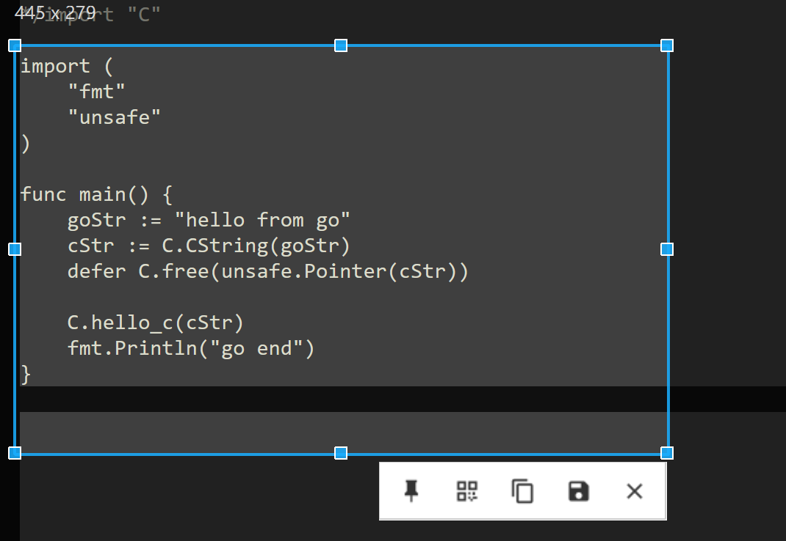 | 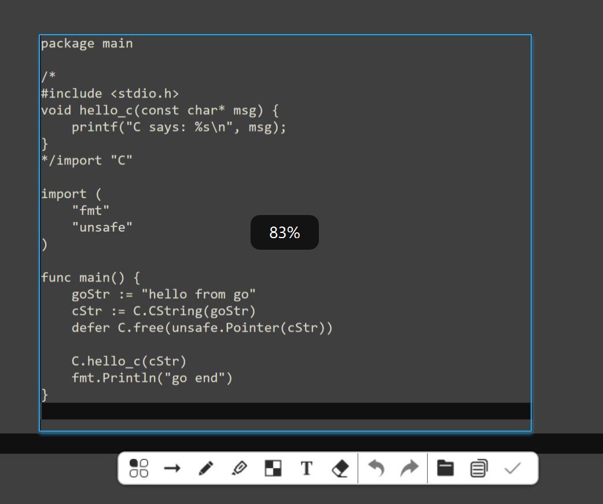 | 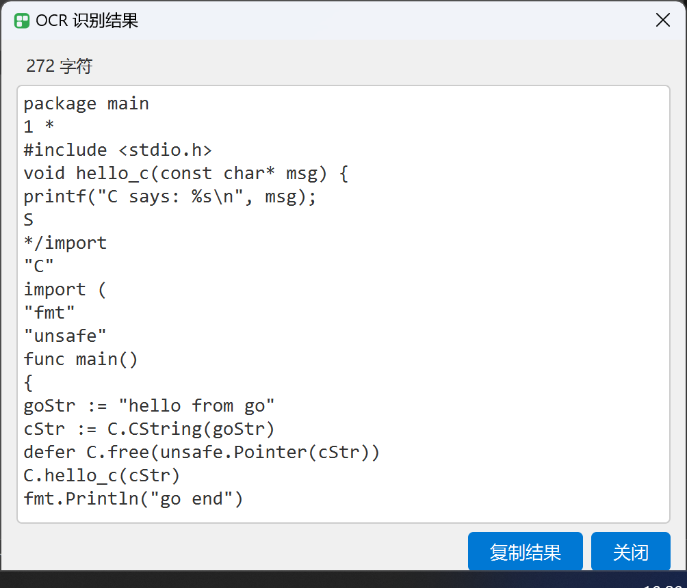 |

## Download & Installation
1. Hol dir die neueste Version unter [Releases](https://github.com/xuhuandeshilinghun/snip‑ocr/releases): `SnipOCR‑<version>‑win64.zip`
2. Entpacke das Archiv in einen beliebigen lokalen Ordner. Portable‑Software, kein Installer erforderlich.
3. Lade das separate OCR‑Modell‑Archiv herunter und entpacke es in den Unterordner `model/` des Programms.
4. Starte `SnipOCR.exe`.

> **System‑Voraussetzung: Windows 10 / Windows 11 x64**
> OCR‑Modell‑Dateien sind groß und sind nicht im Haupt‑Programm‑Archiv enthalten.
> Vermeide das Entpacken in system‑geschützte Ordner wie `C:\Windows` oder `Program Files`, um Lese‑Schreib‑Berechtigungs‑Probleme zu verhindern.

## Tastenkürzel
| Tastenkürzel | Funktion |
|---|---|
| `F1` | Screenshot‑Modus starten |
| `Ctrl+Shift+S` | Screenshot erstellen und OCR‑Erkennung ausführen |
| `Esc` | Beenden / Aufnahme abbrechen |
| `Mausrad` | Auswahl um 1 Pixel feinjustieren |
| `C` | Farbwert aus der Lupe‑Farbauswahl kopieren |

## Technologie‑Stack
- Sprache: C++17
- GUI‑Framework: Qt 6.5.3+
- Build‑System: CMake 3.20+ / MSVC
- OCR‑Inferenz: ONNX Runtime 1.18.1 CPU
- Bildverarbeitung: OpenCV 4.x
- JSON‑Parsing: nlohmann/json
- Zip‑Komprimierung‑Dekomprimierung: minizip
- Windows‑System‑Schnittstellen: Win32‑API, DWM, Low‑Level‑Tastatur‑Hook
- Compiler: MSVC2019 / MSVC2022

## Datenschutz‑ & Sicherheits‑Hinweise
1. Screenshot‑Verarbeitung, Sticker‑Rendering und OCR‑Erkennung laufen vollständig lokal. Die Software **lädt niemals automatisch Screenshots oder erkannte Texte ins Internet hoch.**
2. Die automatische Aktualisierungs‑Funktion stellt Verbindungen zu GitHub / Gitee‑Servern ausschließlich zur Versions‑Validierung und zum Download von Update‑Paketen her.
3. Originale Screenshots werden als Klartext‑PNG im Ordner `history` gespeichert. Säubere den Verlaufs‑Ordner manuell, falls du Passwörter, Ausweisdokumente oder andere sensible Inhalte aufgenommen hast.
4. `.sp1`‑ und `index.dat`‑Dateien nutzen einfache XOR+base64‑Verschleierung **das ist keine sichere Verschlüsselung. Speichere keine hochsensiblen Daten in diesen Dateien.**
5. Du kannst das Speichern des Screenshot‑Verlaufs in den Anwendung‑Einstellungen deaktivieren.

## Bekannte Einschränkungen
- Derzeit wird nur Windows 10 / 11 x64 unterstützt. Linux und macOS sind nicht verfügbar.
- OCR läuft auf CPU‑Basis; die Erkennungs‑Geschwindigkeit hängt von deiner CPU‑Leistung ab.
- OCR‑Modell‑Dateien sind groß und müssen manuell heruntergeladen und bereitgestellt werden.
- Mixed‑DPI‑Mehrmonitor‑Konfigurationen sollten im praktischen Einsatz getestet werden; Kompatibilitäts‑Probleme können bei seltenen speziellen Hardware‑Aufbauten auftreten.

## Mitwirken
Fehler‑Berichte und Funktions‑Wünsche als Issues sowie Pull‑Requests sind willkommen.
1. Fork dieses Repository
2. Erstelle einen Feature‑Branch: `git checkout -b feature/your‑feature‑name`
3. Committe deine Änderungen
4. Pushe den Branch und reiche einen PR ein

> Hinweise zur Einreichung: Committe keine Build‑Artefakte, Inhalte des build‑Ordners oder große Modell‑Dateien. Bevorzuge git‑Submodule für Dritt‑Bibliotheken.

## Entwickler: Erstellen, Verpacken und Veröffentlichen

> Nicht für Endbenutzer, nur für Projekt‑Betreuer.

### Vorverarbeitung der Ressourcen vor der Veröffentlichung

Führen Sie **unbedingt** diese Ressourcen‑Kompilierungsskripte vor jeder Release‑Verpackung aus:

```
# Kompilieren mehrsprachiger Lokalisierungs‑Ressourcen
python tools\compile_locales.py
# Verpacken der Bildressourcen
python tools\pack_img_res.py
```

### Logik zur Auswahl des Update‑Pakets (Regeln des Auto‑Updaters)

| Lokal installierte Version | Herunterzuladender Pakettyp |
| --- | --- |
| V1.0.1 (vorherige offizielle Version) | Delta‑Paket (kleinste Größe, nur wenige MB) |
| V1.0.0 (Basisversion) | Vollständiges Paket (Berechnung der Unterschiede zur Basisversion 1.0.0) |
| Andere ältere Versionen | Vollständiges Paket (Berechnung der Unterschiede zur Basisversion 1.0.0) |
| Nicht installiert | **Zuerst muss die Basisversion V1.0.0 installiert werden** |
 
> ⚠️ `build_release_1.0.0` ist das globale Basisverzeichnis. **Erstellen Sie es einmalig, behalten Sie es dauerhaft, löschen oder ändern Sie es nicht**. Alle nachfolgenden Delta‑Updates hängen von dieser Basis ab.

### Beispiele für das Skript make_release.py

```
# 1.【Nur einmal ausführen】Basisversion 1.0.0 erstellen
python tools/make_release.py --version 1.0.0 --no-build

# 2.Veröffentlichung von 1.0.1 (Basis fest auf 1.0.0, Vergleich mit altem build_release_1.0.0)
python tools/make_release.py --version 1.0.1 --make-update --old build_release_1.0.0 --base-dir build_release_1.0.0 --no-build

# 3.Veröffentlichung von 1.0.2 (Basis fest auf 1.0.0, Vergleich mit altem build_release_1.0.1)
python tools/make_release.py --version 1.0.2 --make-update --old build_release_1.0.1 --base-dir build_release_1.0.0 --no-build

# 4.Veröffentlichung von 1.0.3 (Basis fest auf 1.0.0, Vergleich mit altem build_release_1.0.2)
python tools/make_release.py --version 1.0.3 --make-update --old build_release_1.0.2 --base-dir build_release_1.0.0 --no-build

# Häufig verwendete Befehle
# Kompletter Ablauf: Kompilieren + Sammeln der Release‑Dateien
python tools/make_release.py --version 1.0.1

# Erstellen + Generieren von Voll‑ und Delta‑Update‑Paket
python tools/make_release.py --version 1.0.1 --make-update --old build_release_1.0.0

# Binärdateien bereits kompiliert, nur Verpacken, Build‑Schritt überspringen
python tools/make_release.py --version 1.0.1 --no-build

# Update‑Pakete mit Versionshinweisen und aktiviertem Zwangs‑Update‑Flag erstellen
python tools/make_release.py --version 1.0.1 --make-update --old build_release_1.0.0 --update-log "1.UI optimieren\n2.Bekannte Fehler beheben" --force-update
```

### Kurze Parameter‑Referenz

- `--version x.x.x`: Festlegen der Ziel‑Release‑Versionsnummer
- `--no-build`: C++‑Kompilierung überspringen, nur Verpacken (verwenden, wenn Binärdateien bereits erstellt wurden)
- `--make-update`: Delta‑Paket‑Generierung aktivieren; gibt sowohl Vollpaket als auch Delta‑Patch aus
- `--old <dir>`: Verzeichnis der vorherigen offiziellen Version, zum Dateivergleich für das Erstellen von Delta‑Patches
- `--base-dir <dir>`: Globales Basisverzeichnis, immer auf `build_release_1.0.0` setzen
- `--update-log`: Versionshinweise für diese Version; Zeilenumbrüche mit `\n`
- `--force-update`: Zwangs‑Update‑Flag aktivieren; der Client führt das Upgrade zwingend aus


> Die Build‑Ausgabedateien befinden sich unter `build_release_<version>`. Laden Sie die ZIP‑Archive aus diesem Ordner auf GitHub Releases hoch.

## Lizenz
SnipOCR ist unter der **PolyForm Noncommercial License 1.0.0** lizenziert.
-  ✅ Privat-/Nichtkommerzieller Gebrauch ist frei, Sie können verwenden, modifizieren und teilen.
-  ⚠️ **Jede kommerzielle Nutzung (interne Nutzung durch Gewerkschaftsunternehmen, Integration in kommerzielle Software, Verkauf von Wiederverteilungen) erfordert eine separate kommerzielle Lizenz vom Autor.**
> Kontaktieren Sie mich für die kommerzielle Genehmigung.

## Projekt unterstützen
SnipOCR ist vollständig quelloffen und kostenlos für den privaten Gebrauch. Wenn du dieses Tool nützlich findest, kannst du die weitere Entwicklung freiwillig über Ko‑fi unterstützen:
👉 [https://ko-fi.com/edenls](https://ko-fi.com/edenls)

## Kontakt & Feedback
‑ E‑Mail: senjin@foxmail.com
‑ Es wird empfohlen, Fehler‑Berichte und Funktions‑Vorschläge über GitHub‑Issues einzureichen.
